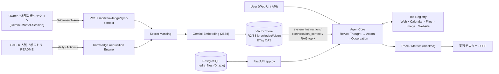

# karry-agent — Autonomous Agent with Knowledge Synchronization Pipeline

[](https://github.com/kek46991-commits/karry-agent/actions/workflows/ci.yml)

**自律型エージェント＆ナレッジ同期パイプライン。** Gemini Function Calling による ReAct 型の自律実行エンジンに、
オーナーが外部セッションから最新の設計ルール・会話文脈・ナレッジを即時反映できる **Knowledge Sync API**、
オープンソース（GitHub）からの **自律的な知識獲得**、それらを実行ごとに取り出す **RAG** を組み合わせた FastAPI サービスです。
公開リポジトリ・公開デモで運用する前提で、**Security-first Design**（fail-closed 認証・秘密情報マスキング・自動検証）を採用しています。

## Architecture



## Core Capabilities

| 領域 | 内容 | 主な実装 |
| --- | --- | --- |
| Autonomous Agent | Gemini Function Calling の ReAct ループ、再試行・指数バックオフ、トレース/メトリクス、マルチエージェント委譲 | `src/karry_agent/core.py`, `orchestrator.py` |
| Knowledge Sync Pipeline | 所有者認証付き API で `system_instruction` / `conversation_context` / `global_knowledge` を同期し、次の実行から即時反映 | `knowledge_sync_api.py`, `knowledge_sync_service.py` — [docs/knowledge-sync.md](docs/knowledge-sync.md) |
| RAG | 依頼文の埋め込みとコサイン類似度で上位 k 件を取得（埋め込み不可時はキーワード検索）。文字数予算付きでシステムプロンプトへ注入 | `knowledge_sync_service.py`, `knowledge_engine.py` |
| Open Source Knowledge Acquisition | GitHub の人気リポジトリ README を毎日取得し、信頼しない参考資料として索引化 | `knowledge_engine.py` — [docs/knowledge-engine.md](docs/knowledge-engine.md) |
| Security-first Design | fail-closed 所有者認証、応答・トレース・SSE の秘密情報マスキング（`sk-...xxxx`）、公開前の人手確認、CI での秘密情報スキャン | `secret_masking.py`, `tests/test_secret_hygiene.py` — [docs/security.md](docs/security.md) |
| Durable State | タスク履歴・成果物を非公開 R2/S3 へ CAS で保存、メディアは PostgreSQL（Drizzle Migration） | `task_persistence.py`, `media_repository.py` |

## Tech Stack

Python 3.11 / FastAPI / Pydantic v2 / google-genai（Gemini・Embedding）/ boto3（Cloudflare R2・S3）/ PostgreSQL（psycopg・Drizzle ORM）/ Vanilla JS SPA / pytest・node:test（jsdom）/ GitHub Actions / Docker / Render

## Repository Layout

```text
app.py                     FastAPI エントリポイント（チャット・SSE・タスク・成果物・各 API）
src/karry_agent/           エージェント本体（core / tools / knowledge_* / secret_masking / persistence ...）
static/index.html          Web UI（タスク管理・チャット・実行モニター）
tests/                     pytest（750+ ケース）と UI DOM テスト
docs/                      機能別の設計ドキュメント
schema.ts, drizzle/        PostgreSQL スキーマと Migration
render.yaml, Dockerfile    デプロイ定義（秘密値はキー名のみ）
```

## Security

- 秘密値は Render の環境変数またはローカル `.env`（Git 管理外）だけに置きます。コミットするのはダミー値の `.env.example` のみです。
- 所有者 API は `KARRY_API_TOKEN` 未設定時に 503 で拒否します。Knowledge Sync API は `X-Owner-Token` / `Bearer` の両方に対応します。
- 応答本文・実行トレース・SSE・ツール結果は API キー、トークン、DB 接続文字列をマスクしてから返します。
- 詳細と自動テストは [docs/security.md](docs/security.md) を参照してください。

## 開発フェーズ履歴

- Gemini API (`gemini-2.5-flash`) 統合
- 堅牢なエラーハンドリング & 指数バックオフ再試行
- `progress.md` へのタスク進捗ログ記録
- 対話型 CLI インターフェース (`cli.py`)
- **Function Calling ツール連携 (`tools.py`)**
- Phase 4 第1ステップ: 現在日時取得・Web検索モックツール
- Phase 5 第1ステップ: Imagen 連携に向けた画像生成モックツール
- Phase 6 第1ステップ: 会話履歴を管理する `ConversationMemory`
- Phase 10: 実 Gemini API を使う ReAct / Function Calling と安全なコマンド実行
- Phase 11: Thought–Action–Observation 実行トレースとローカルスクリプト実行
- Phase 12: API 使用量・実行時間メトリクスと堅牢なエラー処理
- Phase 13: 複数サブエージェントの委譲・並列実行・結果集約
- Phase 14: MVP 統合検証と Devin 引き渡し向けドキュメント
- Phase 16: FastAPI チャット・実行追跡 API とワークスペース一覧ツール

## 🚀 クイックスタート

### 1. 環境構築

```bash
python3 -m venv .venv
source .venv/bin/activate
pip install -r requirements.txt
cp .env.example .env
# .env 内の GEMINI_API_KEY に自身のAPIキーを入力
python3 cli.py
python3 -m pytest -q
```

### 3. Docker で実行

```bash
export GEMINI_API_KEY="YOUR_GEMINI_API_KEY"
docker compose build
docker compose run --rm karry-agent
```

対話モードを終了するには `exit` または `quit` を入力します。API キーはイメージへ埋め込まず、Compose の環境変数から渡してください。

### 2. 外部ツールの確認

```python
from tools import AGENT_TOOLS, get_current_datetime, web_search_mock

print(get_current_datetime())
print(web_search_mock("Gemini API"))
from tools import generate_image_mock
print(generate_image_mock("青い空を飛ぶ白い鳥"))
print(AGENT_TOOLS)
```

### 4. 実 Gemini API の動作確認

`GEMINI_API_KEY` を設定すると、`AgentCore` は `google-genai` SDK の実 API に接続します。既定モデルは `gemini-3.5-flash` で、`GEMINI_MODEL` で変更できます。API 障害・タイムアウト時は指数バックオフで再試行します。

```bash
GEMINI_API_KEY="..." python3 -m karry_agent.cli "README.md の概要を説明してください"
```

エージェントはモデルの Function Call に応じて、ファイル読み書き、Web 検索、画像生成モック、現在日時取得、安全な読み取り系コマンドを実行します。コマンドは shell を経由せず、allowlist とワークスペース制限を適用します。実 API を使うテストは、課金・レート制限を避けるため既定ではスキップされます。

Phase 11 では各ツール呼び出しを `AgentResult.trace` に記録します。トレースには Action 名、引数、Observation、実行時間が含まれます。`run_local_script` はワークスペース内の既存 `.py` ファイルだけを `shell=False` で実行し、引数・タイムアウト・出力サイズを制限します。

Phase 12 では `AgentResult.metrics` に API 呼び出し回数、再試行回数、入力・出力・合計トークン数、ツール呼び出し数、エラー数、総実行時間（ms）を記録します。API エラーとタイムアウトは指数バックオフで自動再試行し、上限到達時は例外を外へ投げずエラー結果へフォールバックします。SDK の usage metadata が返らない場合も処理を継続します。

Phase 13 の `MultiAgentOrchestrator` は、専門分野付きの `DelegatedTask` を複数のサブエージェントへ並列委譲し、結果を入力順に集約します。サブエージェントの失敗は他タスクへ波及せず、タイムアウトやエラーも結果として確認できます。

Phase 14 のシステム構成、公開 API、セットアップ、テスト戦略、Devin 引き渡しチェックリストは [docs/architecture.md](docs/architecture.md) にまとめています。`tests/test_phase14.py` は Gemini 応答モックから Function Calling、ツール Observation、`AgentResult.metrics`、マルチエージェント集約までを一つの E2E フローとして検証します。

Phase 16 の FastAPI では `/chat` がセッション履歴を保持し、`/runs/{run_id}` で完了した実行のトレースとメトリクスを取得できます。`list_workspace` ツールは隠しファイルを除外し、ワークスペース外のパスを拒否します。

### URL解析の短縮経路

単独URLまたは単一ページの解析・要約・改善提案依頼は、`fetch_and_summarize_url`を1回実行し、抽出済みタイトル・本文3000文字・見出し・構造からツールなしのモデル生成で回答します。正常時は2ステップ・1ツール実行、通常1モデル呼び出しです。一般ループの既定上限は100、`KARRY_MAX_TOOL_STEPS`で1～200へ設定できます（長時間実行は [docs/long-run.md](docs/long-run.md)）。取得失敗・JavaScriptページの制約や複合依頼の扱いは [docs/fast-url-analysis.md](docs/fast-url-analysis.md) を参照してください。

### 長時間・低コストの自律実行

既定で最大100ステップまでツールを使い続けます。4ステップごとに古い実行結果を上限4000文字の要約へ置き換え、直近2ステップだけ生のまま残すため、100ステップでもモデル入力はほぼ一定です。`KARRY_LIGHT_PROVIDER=groq|deepseek` を設定すると、最初の計画と最終回答は Gemini、途中の「次にどのツールを使うか」は Groq / DeepSeek（OpenAI互換API）が担当し、Gemini の呼び出し回数を減らします。詳細は [docs/long-run.md](docs/long-run.md)。

### HTML成果物の即時URL公開

`deploy_instant_website` は既定で非公開R2/S3互換ストレージへHTMLを永続保存し、同じ `/static/instant/` URLから配信します。**Renderの再起動・再デプロイで公開済みHTMLは消えません。** Git pushは不要ですが、管理者による一度限りのバケット・S3鍵設定が必要です。設定不足・障害時は一時ディスクへ戻りません。チャットでの全文確認・公開承認とCSP隔離は維持。明示的な `local` モードは一時開発用だけに残します。方式比較・本番設定・旧ページを同じURLで移す手順は [docs/durable-website-storage.md](docs/durable-website-storage.md)、公開APIの使い方は [docs/instant-website.md](docs/instant-website.md) を参照してください。

### タスク管理UIと履歴永続化

タスクの作成・一覧・切替と会話履歴の復元を、既存チャットUIへ統合しています。`/api/sessions`・`/api/chat` は同じ非公開R2/S3へタスクJSONを永続保存し、再起動後も完了済みの会話と最新公開URLを復元します。HTMLと同じ鍵・バケットを使い、専用prefixだけを分ける構成です。一覧・作成・切替はLLMを呼ばず、送信だけ既存AgentCoreへ接続します。CAS・共有リース・再送ID・公開outboxで競合と重複実行を抑止し、資格情報は保存しません。設定と制約は [docs/task-session-chat.md](docs/task-session-chat.md) を参照してください。

### シークレットチャットとマイク

入力欄のシークレットトグルをONにすると、テキスト会話を通常の履歴・DB/R2・実行記録・診断ログに保存せず、独立した揮発メモリだけで処理します。`is_secret` / `isSecret` をAPIへ渡し、OFFでは従来のタスク保存を維持。ON中の画像保存・成果物公開は無効で、既存の合言葉private_modeとは別機能です。Gemini等の外部サービスの保持までゼロにする設定ではありません。

マイクはクリック時に明示的に権限を要求し、全Trackの停止、認識開始/終了/拒否/未対応、手入力と途中結果の合成、タスク切替後の遅延結果を処理します。API・無保存の範囲・対応条件と検証は [docs/secret-chat-microphone.md](docs/secret-chat-microphone.md) を参照してください。

### チャットでの画像生成

チャットで画像を依頼すると、`generate_image` ツールが Gemini（`GEMINI_IMAGE_MODEL`、既定は `gemini-2.5-flash-image`）で画像を作ります。画像はタスクの非公開ストアに保存し、回答の下に表示します。存在しないファイル名や URL は返しません。詳細は [docs/image-generation.md](docs/image-generation.md) を参照してください。

### Creative Video Suite（画像→動画・ナレーション）
チャット下の「🎬 動画を作る」から、写真（任意）・縦横比（16:9 / 9:16）・長さ（1〜120秒）・ナレーションを指定して動画を作ります。既定は **0円ローカル合成モード**（`KARRY_VIDEO_PROVIDER=local`）で、Replicate などの有料動画APIは一切呼ばず、サーバー内の ffmpeg（`imageio-ffmpeg` 同梱）で写真またはタイトルカードにゆっくりしたパンとフェードを付け、ナレーション音声を重ねた1本の MP4 を合成して非公開ストレージに保存します。ナレーションは Gemini TTS（低めの男性声 `Charon`、既存の `GEMINI_API_KEY`）で作り、キー未設定や失敗時はキー不要の無料音声合成（gTTS）で作って MP4 の音声トラックに入れます。どちらも使えないときは無音で「成功」にせず、仮の合図音を入れて `partial`（一部失敗）として画面に理由を出します。Replicate Kling / Runway は `KARRY_VIDEO_PROVIDER` と `KARRY_VIDEO_GENERATION_ENABLED=1` を明示したときだけ使う任意機能です。APIはすべて所有者トークン必須で、キー・ジョブID・出力URLは応答に出しません。詳細は [docs/video-suite.md](docs/video-suite.md)。

フォームの「動画の種類」で **静止画＋音声（0円・高速）**（既定）、**簡易口パク（0円・サーバー内の OpenCV で口元だけ開閉）**、**人物を喋らせる（SadTalker・GPU）** を選べます。SadTalker は写真の顔全体をナレーションに合わせて動かすリップシンクで、SadTalker 等の GPU モデルを Render の外（自分の Colab / Hugging Face Space）で動かし、`KARRY_LIPSYNC_PROVIDER=http|gradio` で接続します（既定は無効・有料APIへのフォールバックなし）。実行先が失敗したときは静止画＋音声の MP4 に戻して `partial` と理由を表示します。手順は [tools/lipsync_server/README.md](tools/lipsync_server/README.md)。

### 自律型知識獲得エンジン

`POST /api/knowledge/sync` が GitHub の人気リポジトリ（指定トピック・★100以上・更新順の上位5件）から README を取得し、Gemini の埋め込みを付けてタスク保存先の R2/S3（`knowledge/index.json`）へ保存します。チャットでは `search_knowledge` ツールで参照します。外部 README は信頼できない参考資料として扱い、指示としては使いません。毎日の同期は `.github/workflows/knowledge-sync.yml` で行います。詳細は [docs/knowledge-engine.md](docs/knowledge-engine.md) を参照してください。

### タスクへの画像添付

`POST /api/upload_image`（multipartのsession_idとfile）でJPG/PNG/WEBP/GIFを読み込み、既存チャットUIからプレビュー・添付取消・画像付き送信ができます。画像バイトはタスクと同じ非公開R2/S3へ保存し、履歴には参照だけを記録します。送信した画像はGeminiの実画像Partへ渡します。GIFは先頭フレームをPNGへ変換。入力4 MiB・正規化後2 MiB・16 MP・次回4枚までに制限し、画像の実形式・向き・メタデータも検証します。アップロード・プレビュー・取消ではLLMを呼びません。画像の予約参照と再送照合で保存障害・古いUI状態を処理します。設定・API・検証結果は [docs/image-attachments.md](docs/image-attachments.md) を参照してください。

### Phase 17: ストリーミングとファイル操作

`POST /chat` に `{"stream": true}` を指定すると、SSE 形式で `started`、`step`（Thought/Action/Observation の実行トレース）、`completed` または `error` イベントを返します。現段階では実行本体を安全に完了させた後にトレースを送る基盤実装であり、真の逐次 Thought 生成は今後のストリーミング SDK 対応で拡張します。

追加ツール:

- `browse_path`: ワークスペース内のファイル内容またはディレクトリ一覧を閲覧
- `append_text_file`: UTF-8 テキストファイルへ追記

いずれもワークスペース外を拒否し、ファイルサイズ・一覧件数を制限します。

## Render への永続デプロイ

リポジトリには Render Blueprint 用の [render.yaml](render.yaml) を含めています。Render Dashboard で **New → Blueprint** を選択し、GitHub の `main` リポジトリを接続して適用してください。

Render の Environment 画面で `GEMINI_API_KEY` を Secret として設定します。`GEMINI_MODEL`、`KARRY_WORKSPACE`、`uvicorn app:app --host 0.0.0.0 --port $PORT`、`/health` のヘルスチェックは `render.yaml` から設定されます。詳細は [HANDOFF.md](HANDOFF.md) の Render 手順を参照してください。

## ジミーモード（プライベートモード）

入力またはセッション内で環境変数 `SECRET_PASSPHRASE` に設定した合言葉 が認証されると、そのセッションの AgentCore にだけジミー用のシステム指示が追加されます。ジミーは、Partnerの相棒・友達として親しみのある大阪弁で応答します。合言葉のないセッションにはプライベートなプロフィールや思い出の指示を渡しません。

この機能はセッション単位のインメモリ認証です。Render などで複数インスタンスを運用する場合は、セッション認証ストアを Redis などへ移行し、認証・監査・失効・レート制限を追加してください。
Render でジミーモードを有効にする場合は、`SECRET_PASSPHRASE` も Environment の Secret として設定してください。未設定ならプライベートモードは無効化され、通常モードで安全に動作します。

### `/agent/run` 互換エンドポイント

旧 Jimmy-Core 形式の `{ "task": "...", "session_id": "optional" }` を受け付ける互換 API を追加しています。内部では既存の `AgentCore`、Function Calling、メトリクス、プライベートモード認証を利用し、旧 `google.generativeai` SDK は使用しません。

### API キー未設定時のエラー

Gemini API キーが未設定の Web Service は、`Internal Server Error` ではなく HTTP 503 と `GEMINI_API_KEY is not set...` の JSON を返します。Render の Environment で `GEMINI_API_KEY` を Secret として設定し、再デプロイしてください。

### Google Calendar 連携

`add_calendar_event` を Function Calling ツールとして登録しています。予定登録は外部データを書き換えるため、最初の呼び出しではプレビューのみ返し、ユーザーが内容を明示確認して `confirmed=true` を指定した場合だけ Google Calendar API を実行します。

Calendar 連携では、メインの Function Calling ループから次の 3 ツールを利用できます。

- `list_calendar_events`: `time_min`、`time_max`、`query` で予定を検索する読み取り専用ツール
- `add_calendar_event`: 新規予定をプレビューし、`confirmed=true` のときだけ登録するツール
- `update_calendar_event`: `event_id` と変更項目を指定してプレビューし、`confirmed=true` のときだけ変更するツール

取得はそのまま実行できます。追加・変更は、エージェントが件名・日時・対象イベントを明示した確認メッセージを返し、ユーザーが承認した後の呼び出しだけが外部 API を変更します。

ローカル設定:

```bash
pip install -r requirements.txt
# Google Cloud Console で OAuth Desktop credentials を取得
export GOOGLE_CALENDAR_CREDENTIALS_FILE=/secure/path/credentials.json
export GOOGLE_CALENDAR_TOKEN_FILE=/secure/path/token.json
export GOOGLE_CALENDAR_ALLOW_LOCAL_OAUTH=1
```

初回 OAuth はローカル端末でのみ実行してください。`credentials.json` と `token.json` は `.gitignore` 対象で、Git、Docker image、ログへ含めないでください。Render のようなヘッドレス環境では既存の OAuth token を Secret / 安全な永続ストレージから提供し、対話型ログインを起動しないでください。

Render Blueprint では `GOOGLE_CALENDAR_TOKEN_JSON` と `GOOGLE_CALENDAR_CREDENTIALS_JSON` を Secret として定義しています。ローカルで OAuth を完了した後、Render Dashboard の Environment に JSON の内容を Secret として登録してください。アプリは起動時に `/tmp/karry-agent/` へ mode `600` の一時ファイルとして復元します。Render のファイルシステムは永続ではないため、再起動後も Secret から再復元されます。Render では `GOOGLE_CALENDAR_ALLOW_LOCAL_OAUTH` を設定せず、ヘッドレス OAuth を起動しないでください。

Render への設定は `scripts/push_calendar_env.py` で自動化できます（標準ライブラリのみ、Termux でも動作）。`credentials.json` / `client_secret*.json` / `token.json` をカレントディレクトリ・リポジトリ・ホーム・Download から自動検索し、JSON 形式と必須項目（`installed`/`web` の `client_id`・`client_secret`、token の `refresh_token`）を検証して 1 行 JSON として Render API に登録し、デプロイします。値は表示しません。

```bash
export RENDER_API_KEY=rnd_xxx
python scripts/push_calendar_env.py --render          # ローカルのファイルを登録してデプロイ
python scripts/push_calendar_env.py --login --render  # token.json をブラウザ認証で作成してから登録
python scripts/push_calendar_env.py --from-render     # Render の既存値を正規化して再登録
```

アプリ側も前後の空白・BOM・外側のクォート・`KEY=` 付き・二重エンコード・base64 の値を自動で正規化します。設定状態は `GET /health/calendar` で確認でき、レスポンスには有無と形式エラーだけが含まれ、値は含まれません。

本番の Render サービス構成（`karry-agent-1` が本番）、環境変数の一覧、PR #3 の変更内容、Termux での再設定手順、トラブルシューティングは [docs/calendar-setup.md](docs/calendar-setup.md) にまとめています。

### 追加登録が実行されない場合の修正（2026-10-13）

ヘッドレス環境では、OAuth 完了済みの `GOOGLE_CALENDAR_TOKEN_JSON` が有効なら、補助的な `GOOGLE_CALENDAR_CREDENTIALS_JSON` の復元・検証より token の読み込みと refresh を先に行います。これにより、credentials Secret の形式不正があっても、有効な authorized-user token によるイベント登録を妨げません。

また、チャットで予定プレビューの後にユーザーが「はい」「登録してください」など明示確認した場合は、会話モデルの再判断に任せず、保留中の予定を `add_calendar_event(..., confirmed=True)` で直接実行します。これにより、確認後に再びプレビューだけ返る問題を防ぎます。`/health/calendar` が token を `valid: true` と示すこと、OAuth token のスコープが `https://www.googleapis.com/auth/calendar.events` であることを確認してください。

確認後のCalendar API例外はHTTP 500へ投げ直さず、ユーザー向けの登録失敗結果とエラーメトリクスへ変換します。天気の質問には `get_weather(location)` がFunction Callingから選択され、Open-Meteoのジオコーディングと現在天気APIを順に呼び出します。例: `枚方市`。APIキーは不要で、取得元はレスポンスの `source` に明示されます。汎用 `web_search` が空結果の場合も `message` を返します。

Calendar追加は「明日の10:00」「明日の10時30分」のような日本語の相対日時にも対応し、JSTのISO8601（例: `2026-10-14T10:00:00+09:00`）へ変換します。Google APIの認証・refresh・insert例外は`agent execution failed`へ漏らさず、「カレンダー連携の認証が必要です」などの安全な結果として返します。標準の本番環境変数はJSON Secretですが、互換用に`GOOGLE_CLIENT_ID`、`GOOGLE_CLIENT_SECRET`、`GOOGLE_REFRESH_TOKEN`の3つでも構成できます。

### 統合エージェント・コア

`agent_core.py` の7関数インターフェースを既存のツールレジストリとAPIへ統合しました。`execute_command`、`list_dir`、Google Photos Picker、Google Maps Routes APIを追加し、ファイルの `filepath` / `path` 引数とCalendarの `end_time` / `description` に対応します。Calendar追加はモデル自身の `confirmed=true` を承認とせず、チャットAPIの保存済みプレビューへの明示確認で実行します。

新しい直接ツールAPIは `GET /api/agent/tools` と `POST /api/agent/tools/execute` で、`KARRY_API_TOKEN` が必要です。tokenを設定すると既存のチャット・実行・履歴APIもBearer認証を要求します。任意シェルは既定で無効にし、既存コマンド方針を維持しています。Photosは全ライブラリの無人検索ではなく、ユーザー選択済み写真の取得です。OAuthの共通化、必要な設定、制約、検証、Render配置の詳細は [docs/unified-agent-core.md](docs/unified-agent-core.md) を参照してください。

### Self-Healing Core

API例外、コア障害、Gemini再試行、ツールの例外・構造化エラーを共通の `SelfHealingEngine` へ集約します。上限付き・秘密情報除去済みの診断ログ、登録式修復と再検証、設定済みワークスペース復元、送信側Bearer補正の軽量クライアントを追加しています。受信401は維持し、検証していない修復やパッチを成功扱いにしません。

未知のコード障害のAI修復候補生成とGitHubドラフトPR提出は明示設定で有効化できます。既定は無効で、本番checkoutやmainを無検証で書き換えません。状態・診断ログは認証付きの `/api/agent/healing` と `/api/agent/healing/incidents` から確認できます。詳しくは [docs/self-healing.md](docs/self-healing.md) を参照してください。

### Optimus Core（自己進化・クローン生成）

`/api/optimus/*` で、クローン「ケリーエージェント」（2号以降）の生成・実行と、自己コードの変更案 → GitHub PR → CI成功後のマージ（Render自動デプロイ）を行います。変更案はプレビューとSHA-256確認が必須で、認証・秘密情報・CI・Render設定は書き換え禁止です。マージは `KARRY_OPTIMUS_AUTO_MERGE=1` の場合のみ実行します。詳しくは [docs/optimus-core.md](docs/optimus-core.md) を参照してください。

### ジミーのCore Context

`src/karry_agent/jimmy_core_memory.json` は、ジミーの大阪弁の相棒像・長期目標・開発原則を含む汎用公開テンプレートです。個人名は保存せず、呼称は非公開環境変数 `PARTNER_NAME` または `CORE_USER_NAME` から読み込みます。未設定時は `Partner`。wheelにも汎用JSONだけを同梱し、新しいセッションや再起動でも設定を読み込みます。

個人プロフィール・私的記憶はコードへ保存せず、必要な場合だけ非公開の `CORE_PRIVATE_CONTEXT` から認証済みプライベートモードへ渡します。認証やSelf-Healingの有効化設定は変更しません。設定方法、モデルへ渡る情報、公開履歴の制約は [docs/jimmy-core-memory.md](docs/jimmy-core-memory.md) を参照してください。

## PostgreSQLメディア管理

`schema.ts`のDrizzle定義とMigrationで`media_files`を作成し、Python/FastAPIから同じPostgreSQLへ画像を保存します。所有者認証付きの`/api/media/upload`、FLUX生成・状態照会、非公開一覧・読取を追加しています。旧チャット画像添付のR2/Gemini経路は維持します。管理者がDATABASE_URLを秘密設定へ登録して`npm run db:migrate`を適用してください。生成はREPLICATE_API_TOKENと明示有効化が必要で、既定では課金APIを呼びません。接続先・保存・再送・本番未適用の詳細は[メディアDBガイド](docs/media-postgres.md)を参照してください。

## SQL動画プロジェクトと0円プレビュー

動画プロジェクトCRUD（SQLite／PostgreSQL）と、アップロード画像＋ローカルTTSによるMP4プレビューを本体へ追加しました。動画UIの「0円プレビュー」は外部生成APIなしで動作し、既存のAI動画UIは保持します。要求された`/api/video/projects`と`/api/video/generate/*`を提供し、新しいジョブは既存ルートと衝突しない`/api/video/project-jobs/*`へ配置します。KARRY_API_TOKEN認証、OSツール、Renderネイティブ／Dockerの違い、永続ストレージ、AI最大10秒、日本語TTSの制約は[動画プロジェクトガイド](docs/video-projects.md)を参照してください。
